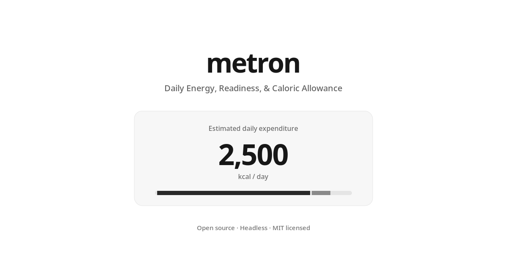

<div align="center">



# Metron

**Daily Energy, Readiness, & Caloric Allowance**

An open-source fitness instrument with an independently usable, headless calculation engine.

[](./LICENSE)   

**[Try it](#try-it-in-60-seconds)** · **[Use the engine](#for-agents--builders)** · **[Inspect the models](#what-is-and-isnt-established)** · **[Contribute](./CONTRIBUTING.md)**

</div>

> I wanted to understand how sleep, body composition, physical activity, and training volume interact. So I built a calculator, documented my assumptions, and open-sourced the homework.

**Use it. Fork it. Disagree with it. Improve it.** Metron is an exercise in applied physiology and software design—not a claim to know someone's true calorie burn or how recovered they are.

## One project. Two front doors.

| For people | For agents, builders & researchers |
| --- | --- |
| A mobile-first instrument. Adjust steps or workout time and see the estimate change immediately; open the method only when you want more depth. | A pure JavaScript module, deterministic CLI, typed interfaces, JSON Schemas, runnable examples and research documentation. **No browser needed.** |
| [Open the UI guide](./docs/DESIGN.md) · [View screenshots](#the-instrument) | [Read AGENTS.md](./AGENTS.md) · [Machine manifest](./metron.manifest.json) · [API](./docs/API.md) |

### The instrument

<p align="center"></p>

<details><summary><strong>See the mobile experience</strong></summary>
<br/>
<p align="center"></p>
</details>

## What exists today

| Surface | What it does | Evidence status |
| --- | --- | --- |
| **Energy** | Estimates RMR and daily expenditure from body profile, steps and workouts. | Published equation components + explicit simplifying assumptions; **not individually validated**. |
| **Readiness** | Explores sleep, subjective energy and fatigue to help adjust training decisions. | **Unvalidated coaching heuristic**, not a physiological recovery measurement. |
| **Body** | Compares standard and optional fat-free-mass equations. Tracks SMM without treating it as an extra calorie bonus. | Population estimates; body-composition inputs may be imprecise. |
| **Caloric Allowance** | Goal-aware intake planning. | **Planned; not implemented.** TDEE does not equal an eating allowance. |

**WHOOP, Garmin, Apple Health, direct wearable synchronization, MCP, and Bayesian calibration are also planned—not shipped.** See the [research agenda](./docs/RESEARCH.md) and [future architecture](./docs/FUTURE_ARCHITECTURE.md).

## Try it in 60 seconds

**Before GitHub publication:** unzip the release archive and run these commands from its `metron/` folder. Once the public repo exists, `git clone https://github.com/andydrewie/metron.git` will work as well.

```bash
npm run dev                  # http://127.0.0.1:4173
npm run ci                   # syntax, software tests, static Pages build
npm run release:check        # package/design/deployment preflight
```

Node 20+ is required for the development scripts. **No `npm install`, sign-in, API key or server-side calculation service is required.** The deployment artifact is a static website suitable for GitHub Pages.

## For agents & builders

```js
import { evaluate } from './core/model.js';

const input = {
  profile: { weightKg: 80, heightCm: 175, ageYears: 30, equationSex: 'male' },
  activity: { steps: 10000, workoutMinutes: 60, intensity: 'typical' },
  recovery: { sleepHours: 7.5, energy: 'good', weekly: 'mixed' }
};
const result = evaluate(input);
console.log(result.energy.estimatedTdeeKcal, result.recovery.status);
```

**Zero-install CLI:**

```bash
node bin/metron.mjs --file examples/beginner.json
cat examples/strength-athlete.json | node bin/metron.mjs
node bin/metron.mjs --example
```

The browser and CLI import the **same model**. Agents should read [`AGENTS.md`](./AGENTS.md) for invariants, [`metron.manifest.json`](./metron.manifest.json) for implemented-vs-planned capability flags, [`schemas/`](./schemas/) for input/output contracts, and [`core/model.d.ts`](./core/model.d.ts) for types. A lightweight resource index is provided in [`llms.txt`](./llms.txt); it is a convenience, not an official standard.

<p align="center"></p>

## What is and isn't established

Metron separates **observations**, **inferences**, **decisions**, and **future outcomes**. A vendor's recovery score is not ground truth. WHOOP RMSSD and Apple Health SDNN, for example, must not be silently treated as the same HRV measurement. Steps already counted during a workout can also be counted again in the walking estimate; the current engine **warns** about possible overlap but does **not** reconcile it.

<p align="center"></p>

**The research question:** Does adding wearable and longitudinal data actually improve held-out training-performance predictions beyond knowing how someone slept, feels, and performed previously? A *negative* result would still be useful.

Read the [scientific assumptions](./docs/SCIENCE.md), [current architecture](./docs/ARCHITECTURE.md), [prospective research protocol](./docs/RESEARCH_PROTOCOL.md), and [unrun research protocol](./research/protocol.json). **Software tests are not physiological validation.** No measured individual accuracy or calibrated confidence intervals are claimed.

## Repo map

```text
metron/
├── README.md                 # Human story, real UI, honest status
├── AGENTS.md                 # Machine-readable engineering instructions
├── metron.manifest.json     # Capability truth: implemented vs proposed
├── core/                     # One deterministic, headless source of truth
├── schemas/ + examples/     # Typed JSON contracts and synthetic cases
├── bin/ + tests/            # CLI and software verification
├── index.html + app.js      # Static reference instrument
├── design/tokens.json       # Canonical design tokens → generated CSS
├── docs/assets/             # Real screenshots and editable SVG diagrams
├── research/                # Explicitly prospective, unrun evaluation
├── .github/                 # CI, GitHub Pages and contribution templates
└── docs/                    # Science, methods, design, research, deployment
```

The compact, monochrome **V4 Research Instrument** visual language—guided by native ChatGPT interaction conventions, not OpenAI branding—is documented in [DESIGN.md](./docs/DESIGN.md). It uses semantic CSS tokens and standard browser controls without making React, shadcn/ui or Tailwind dependencies of the engine.

## Fork the homework

MIT-licensed and open to corrections. Share reproducible counterexamples, better equations with evidence, accessibility improvements, carefully controlled validation, and negative findings. Use synthetic or permission-cleared data only; don't publish private wearable exports in issues.

**[Contributing](./CONTRIBUTING.md)** · **[Research questions](./research/README.md)** · **[Design tokens](./design/tokens.json)** · **[Deployment instructions](./docs/DEPLOYMENT.md)** · **[Release QA](./docs/QA.md)**

**Publication status:** local pre-publication package. The GitHub URL and Pages deployment must be independently verified before being called live. **Source package:** `0.2.0-alpha.3`; **underlying calculation model:** `0.1.0`.

<div align="center"><sub>Complexity in the engine. Clarity in the cockpit. · MIT</sub></div>
