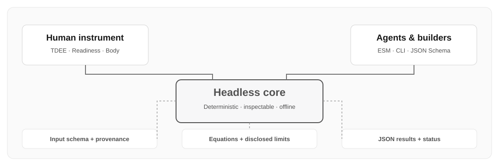
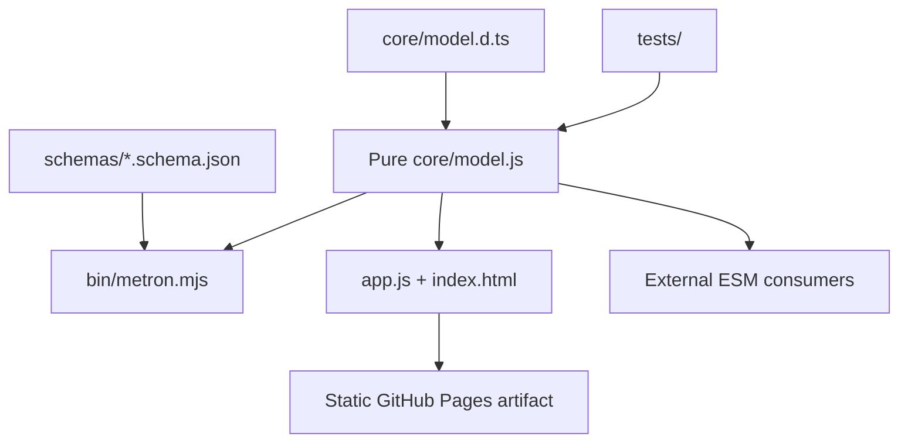

# Implemented architecture — one model, three client surfaces

This document is about **what currently exists**. Read [future architecture](./FUTURE_ARCHITECTURE.md) for proposed data provenance layers, wearable adapters, a temporal energy ledger, individualized calibration and allowance models.

## Current exports

`normalizeInput`, `mifflinStJeor`, `fatFreeMassKg`, `cunninghamRmr`, `estimateEnergy`, `evaluateRecovery`, and `evaluate`. See [API](./API.md). The core is ESM, has zero runtime dependencies, does not contact external services, and has deterministic outputs from fixed inputs.

The browser holds a local in-memory `state` and imports `evaluate`; it does **not** repeat the equations. It provides tabs for **Energy**, **Readiness** (internally `recovery`) and **Body**. JavaScript and CSS are served as static files; no user account is necessary. The CLI reads JSON from stdin or `--file` and prints JSON for agents.

## Current model version vs packaging

The deterministic model reports `modelVersion: 0.1.0`; the rebranded repository package is `0.2.0-alpha.3`. Renaming a project does not magically validate its math. Numerical coefficient changes should receive independent tests, rationale and release notes even when API signatures don't change.

## Important current limitations

- **Baseline:** RMR × 1.2 is an assumed sedentary convention; it is not an individual measurement.
- **Walking:** 2,000 assumed baseline steps, height-derived stride, level walking net cost.
- **Gym:** approximate whole-session MET; may overlap with reported steps.
- **Recovery:** chosen set-ranges and sleep cutoffs are unvalidated coaching heuristics.
- **Allowance:** not implemented. The energy number must never be relabeled an intake target.
- **Wearables:** no direct import, OAuth, or native HealthKit access yet.
- **Privacy:** the core is offline and static; exported JSON may contain personal metrics. Hosting/CDN may maintain ordinary access logs that are outside the app's control.

The software stack has no analytics, cookies, external runtime SDKs or browser persistence. No promise is made about external hosting infrastructure logs.

## Engineering invariants

- Typed explicit units and documented defaults; never silently add SMM to FFM.
- Preserve conditional warnings and error contracts.
- Keep UI, CLI and future integrations on the same core API.
- Do not claim calibrated confidence or zero double-counting until validated.
- Keep roadmap capabilities in `metron.manifest.json` as `false` until functioning and tested.
