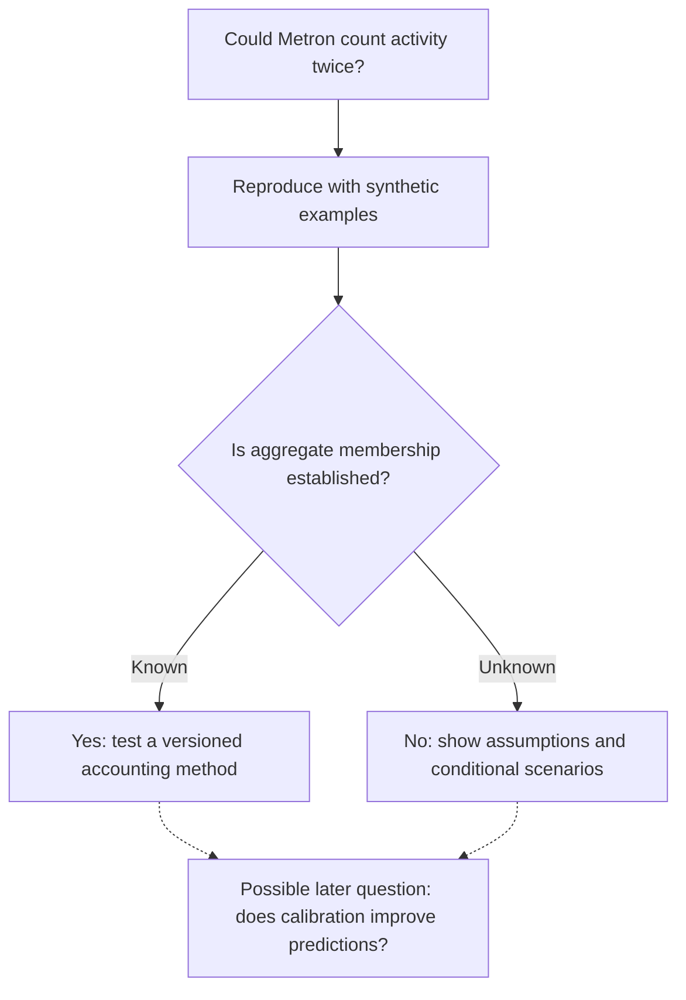

# Metron — a living map of questions

## At a glance

**What works:** Metron's free Energy / Readiness / Body instrument, deterministic JavaScript model, and JSON CLI.

**What we've reproduced:** Synthetic steps and workout inputs admit different overlap interpretations. [Explore the research-only arithmetic audit](../research/energy-accounting/README.md). The consumer model is unchanged; [source-aware activity-event contract research](../research/activity-events/README.md) now tests period provenance separately from step inclusion. [Issue #1](https://github.com/andydrewie/metron/issues/1) remains open for actual accounting evidence.

**Provider evidence:** [WHOOP, Garmin and Apple HealthKit review](../research/provider-step-semantics/README.md) found no universal workout-step-inclusion guarantee in the official public sources examined. Researching Apple sample-level attribution comes before any real integration.

**New opt-in research tool:** [Apple HealthKit sample-attribution pilot](../research/apple-healthkit-pilot/README.md) is a local-only Xcode/iPhone experiment. It is not part of the live website and cannot be run against real data without on-device Health permission.

**Device-free research:** [Coefficient sensitivity audit](../research/assumption-sensitivity/README.md) tests how changes to stated assumptions move the modeled output. It requires no equipment or personal records. The optional HealthKit pilot is **not** a prerequisite for future work.

**Current empirical research program:** [G3 measured-RMR results](../research/ree-validation/G3_RESULTS.md) are published for 454 eligible participants under the frozen G1 protocol. Mifflin MAE is 165.7 kcal/day; Cunningham is 129.5 in the same people. This is one cohort with BIA-estimated FFM, not TDEE or readiness validation. **[G4 is complete](../research/ree-validation/G4_DECISION.md): retain Mifflin as default and Cunningham as an explicit option with population/input-quality guidance.** Execution now follows the [durable evidence program](../research/robustness/README.md): ontology/applicability, current evidence and measurement review precede further cohort evaluation. The independent athlete replication is now recorded in H4; numerical coefficients remain unchanged. [Track evidence](https://github.com/andydrewie/metron/issues/9).

**Current robustness program:** [checkpoint](../research/robustness/CHECKPOINT.md) · [canonical gate/weakness state](../research/robustness/plan.json) · [tracker #22](https://github.com/andydrewie/metron/issues/22). H0–H5 are complete at declared scope; H7 is under verification. H6 human evidence and H8 fresh-agent recovery remain blocked. Research reuse through 7 November 2027 is independently valuable; clinical applicability remains unreviewed.

**What might follow:** A personal-calibration experiment, but only if it adds useful evidence. Caloric Allowance and wearable integrations remain possibilities, not promises.

**How to use this roadmap:** Use the current program for execution order. The activity flow below illustrates one open research branch. [Information design principles](./INFORMATION_DESIGN.md).

> **No deadlines, growth targets, or promises.** Metron is open homework: a beautiful, headless instrument for testing what we think we know about energy, training readiness, and nutrition. This document is a map of considerations, **not** a committed feature schedule.

**Snapshot:** 2026-11-07 · **Current status:** Public MIT-licensed exploratory source and GitHub Pages app; Energy / Readiness / Body UI; deterministic JavaScript core + JSON CLI. **Not shipped:** personalized calibration, Caloric Allowance, wearable imports, injury prediction, scientifically validated training prescription.

**The premise:** I wanted to understand how sleep, body composition, physical activity, and training volume interact. So I built a calculator, documented my assumptions, and open-sourced the homework.

## The one invariant

**Observe → Infer → Decide → Evaluate.**

- **Observe:** data with definitions, units, time intervals, provenance, and known limitations.
- **Infer:** estimates with methods, assumptions, and evidence levels.
- **Decide:** options conditional on human goals and constraints; not disguised measurements.
- **Evaluate:** prospective outcomes compared with previously frozen predictions, including negative results.

The three user-facing concepts are **Daily Energy**, **Readiness**, and eventually **Caloric Allowance**. **Body** is currently a third UI tab and shared model input, not a new physiological claim. No redesign is necessary to research the underlying engine.

## One open branch: activity accounting

**Text equivalent:** Reproduce overlap with known examples. When aggregate membership is identifiable, test an explicit accounting alternative. Clock overlap alone is insufficient. When membership is unknown, show transparent alternative scenarios. Either result may motivate calibration research, but neither commits us to a feature.

## Open energy-accounting questions within H3

We begin with *correctness, provenance, and uncertainty honesty*, not extra inputs or AI branding.

| Question | Smallest useful experiment | Exit condition |
| --- | --- | --- |
| Are we counting energy twice? | Reproduce a day where walking steps include a treadmill workout also entered as exercise | Distinguish known overlap, unknown overlap, and disjoint activity; no silent double addition once a reconciled mode is enabled |
| How honest is our sedentary baseline? | Compare zero-, 2k-, 10k-, and 20k-step synthetic days and alternative baseline choices | Document and test low-step behavior; explain what 1.2 × RMR includes |
| Are activity estimates reproducible? | Fixed synthetic fixtures for weight, step length, workout minutes, and whole-session MET choices | Same well-defined units and outputs across SDK, CLI, and browser |
| Do our outputs tell the truth about evidence? | Audit warnings, machine manifest, README, and model response semantics | Never imply measured TDEE, validated recovery thresholds, or personal uncertainty intervals |
| Can a novice still use the instrument? | Narrow-screen and keyboard regression checks; verify labeled slate/blue/copper charts in grayscale | Preserve V4.1 usability without requiring additional onboarding |

**Policy for ambiguous overlap:** first *surface the ambiguity*, with explicit assumptions or conservative scenarios. Do not manufacture precision or automatically subtract exercise calories without enough information. Retain the current simple API until a versioned, tested alternative earns inclusion.

**Existing scoped issue:** `Energy accounting: model overlap and baseline assumptions`. Do this before adding a wearable or intake goal to the core.

## Later H6 branch: personal calibration, if the evidence warrants it

Question: *Can longitudinal intake and weight observations improve an individual's TDEE estimate over a simple population baseline?*

1. Design a **local-first, opt-in** protocol using synthetic examples before asking for any human data.
2. Define units, recording frequency, missing data, likely intake error, fluid-weight shifts, and minimum history needed for a meaningful comparison.
3. Compare a **fixed baseline** with a plainly described correction model. Never call a range calibrated or Bayesian without independent validation.
4. Hold back later observations for a **forward-time evaluation**. Report bias and error, and be prepared for *no improvement*.
5. Keep exported observations under the user's control; no account, cloud upload, analytics, or model training by default.

A calibration feature is an **experiment**, not a promised next release.

## Possible later branches, chosen by curiosity and evidence

| Exploration | What must be true first | Avoid |
| --- | --- | --- |
| **Caloric Allowance** | Explainable, goal-aware intake planning that uses smoothed energy estimates and reasonable safeguards | Equating today's TDEE with how much one *must* eat |
| **Wearable inputs** | Provenance-aware schema and transparent temporal mapping of sleep, steps, RHR, HRV, workouts | Treating WHOOP, Garmin and Apple Health vendor scores or HRV definitions as interchangeable |
| **Training-readiness research** | Prespecified performance outcomes, honest human-reported context, future-session evaluation | Calling chosen sleep/set thresholds clinical or injury-safe |
| **Bayesian updating** | Real likelihood model, documented priors, measurement-error assumptions and tested predictive coverage | "AI" or confidence-score theater |
| **MCP / agent adapters** | Stable headless contracts and useful agent workflows, independent of vendor APIs | Duplicating physics or giving autonomous diet/medical instructions |
| **UI refinements** | Real usability friction, accessibility evidence, or a concrete information need | Redesigning our already useful compact cockpit for novelty |

**The right to stop:** a negative experiment, a maintained simple baseline, or no new feature can all be successful outcomes. No schedule is implied by ordering.

**Public reasoning culture:** [Collaboration policy](./COLLABORATION.md) · [Vocabulary](./VOCABULARY.md) · [Accepted decisions](./adr/README.md). The roadmap presents questions, not a mandate to generate artifacts or pursue every possible feature.

## How we work in this repository

- **Human entrance:** [README](../README.md), [live instrument](https://andydrewie.github.io/metron/), [science](./SCIENCE.md). Let visitors understand the tool before the mathematics.
- **Agent entrance:** [AGENTS.md](../AGENTS.md), [machine manifest](../metron.manifest.json), [schemas](../schemas/), [CLI](../bin/metron.mjs), [fixtures](../examples/). Never infer implemented features from this roadmap.
- **Scientific entrance:** [research questions](./RESEARCH.md), [prospective protocol](./RESEARCH_PROTOCOL.md), [implemented architecture](./ARCHITECTURE.md), [future design](./FUTURE_ARCHITECTURE.md).
- **Issue discipline:** open an issue for a specific falsifiable question, reproducible defect, or well-defined design decision; don't generate dozens of speculative tickets. Link the evidence and say what a negative finding would mean.
- **Code discipline:** preserve pure calculations and deterministic JSON, version behavior changes, update types/schema/examples/tests together, and distinguish mathematical tests from biological validation.
- **Privacy & safety:** no wearable credentials or private health exports in issues, commits, examples or telemetry. No harsh intake targets or claims of medical safety.

**When to revisit this map:** after evidence changes or a material new question, and when the [source-specific freshness policy](../research/robustness/README.md#freshness-from-the-first-gate) requires review. Review intervals govern evidence currency, not feature deadlines. No background monitor is installed.
