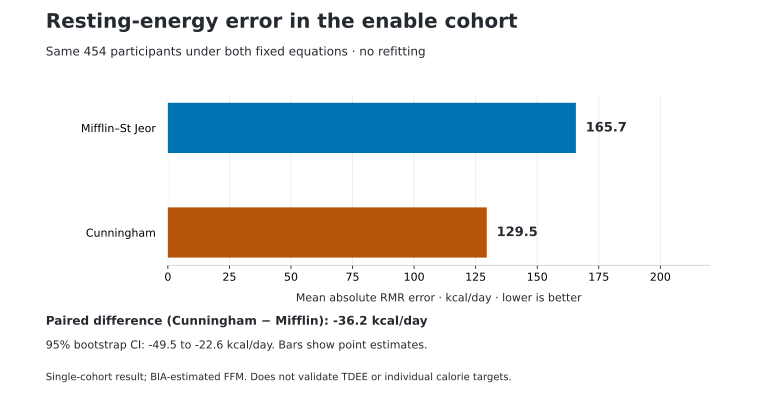
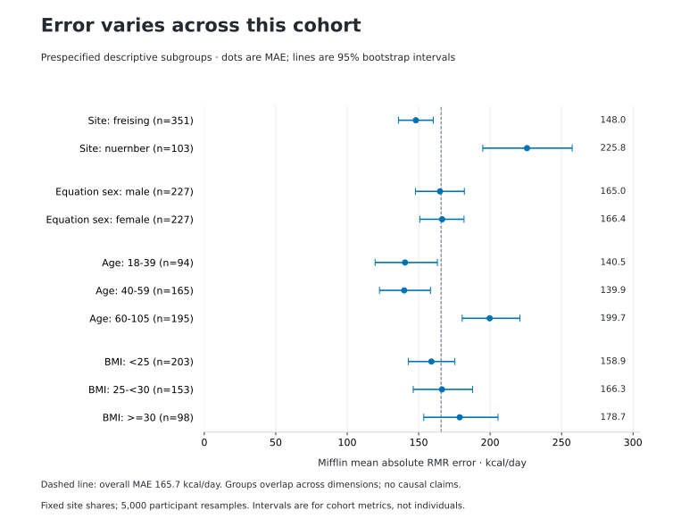

# G3 · Measured resting-energy results

## In 20 seconds

**On the same 454 eligible adults, Mifflin's mean absolute RMR error was 165.7 kcal/day; Cunningham's was 129.5.** The paired difference was −36.2 kcal/day (95% bootstrap CI −49.5 to −22.6), favoring Cunningham descriptively in this cohort. Mifflin underpredicted by 134.7 kcal/day on average. A separate Python calculation reproduced all reported metrics and intervals. **This is one released cohort, with BIA-estimated fat-free mass, not validation of TDEE or individual calorie targets.** The subsequent [G4 decision](./G4_DECISION.md) retains the default with scoped guidance; production calculations are unchanged.

---

Study **RMR-EXT-001** · Protocol **RMR-EXT-001-G1-v1** · Analysis **6 November 2026**  
[Dashboard #9](https://github.com/andydrewie/metron/issues/9) · [G3–G4 issue #13](https://github.com/andydrewie/metron/issues/13) · [Aggregate JSON](./results/g3-enable-v1.json) · [Calculation audit](./results/g3-audit-v1.json) · [Run provenance](./results/G3_RUN.json)

## What was measured, and what we compared

The reference is **resting metabolic rate measured by indirect calorimetry**, converted from `RMR.KJ` to kcal/day by dividing by 4.184. The source publication describes fasting measurement with a COSMED Quark RMR canopy and SECA 515 bioimpedance for fat-free mass (FFM). We evaluated the existing fixed Metron implementations of Mifflin–St Jeor and Cunningham, without training, coefficient changes, or outcome-dependent exclusions.

The source is Brandl and colleagues' **enable** data from Freising and Nuremberg. Only the pinned `enable_data.tsv` file was admitted. Its extension is misleading: it is comma-delimited CSV. The source record is open under **CC BY 4.0**; attribution and source links are retained below. We did not pool the enable workbook, Kiel data, or other candidates.

**Scope of the reference:** we verified released file identity and followed the published measurement description. We did not recalibrate instruments or independently verify each participant's fasting/rest conditions. The equation-versus-reference differences combine prediction error with reference-measurement variability; this analysis does not decompose those components.

## Participant flow and missingness

| Frozen screening step | Removed at this step | Remaining |
| --- | ---: | ---: |
| Raw rows, all with distinct nonblank IDs | 0 | 459 |
| Supported source equation-sex code | 0 | 459 |
| Age 18–105 and finite | 1 | 458 |
| Height 100–250 cm and finite | 0 | 458 |
| Weight 25–350 kg and finite | 0 | 458 |
| Positive finite measured RMR | 4 | **454** |
| FFM 5–150 kg and no greater than weight | 0 | **454 paired** |

The one first excluded for age also fails height, weight and reference checks. Across all raw rows, independent invalid/missing counts are **age 1, height 1, weight 1, reference 5, equation-sex 0**. These overlap and must not be added as distinct excluded people. FFM is valid in all 454 primary-eligible observations. No imputation or winsorization was used; valid positive reference outliers were retained. No unknown-site records entered analysis.

Final N happens to equal G0's provisional 454, but it was obtained by the frozen filters, not hardcoded. The cohort contains **351 Freising and 103 Nuremberg participants**, and **227 each** in the recorded male/female equation categories. Those categories map the published binary equation parameter and do not infer gender identity.

## Primary result: Mifflin–St Jeor

| Metric | Estimate | 95% bootstrap interval |
| --- | ---: | ---: |
| Mean absolute error, kcal/day | **165.7** | 154.3 to 177.9 |
| Mean signed bias, kcal/day | **−134.7** | −149.1 to −120.1 |
| Root mean squared error, kcal/day | 210.8 | 196.8 to 224.9 |
| Median absolute error, kcal/day | 136.6 | 124.7 to 148.9 |
| Within ±10% of measured RMR | 54.8% | 50.4% to 59.3% |

Bias is **predicted minus measured**: the negative sign means average underprediction. MAE describes the average magnitude of an error, not an individual's guaranteed error bound. The larger RMSE and lower median absolute error show that larger misses influence the mean. We did not remove those records after observing their errors.

The ±10% statistic is descriptive. It is not a prespecified pass threshold, a personal confidence score, or the chance that a future user's estimate will be correct.

## Paired comparison: exactly the same people

| Metric | Mifflin | Cunningham |
| --- | ---: | ---: |
| Participants | 454 | 454 |
| MAE, kcal/day | 165.7 | 129.5 |
| Signed bias, kcal/day | −134.7 | +34.1 |
| RMSE, kcal/day | 210.8 | 160.5 |
| Median absolute error, kcal/day | 136.6 | 110.0 |
| Within ±10% | 54.8% | 65.9% |

**Cunningham minus Mifflin MAE: −36.2 kcal/day; 95% paired interval −49.5 to −22.6.** The same resampled people are used for both equations, preserving the paired comparison. This describes lower observed average error for Cunningham here, without a universal-superiority claim or p-value.

Cunningham requires FFM, which is **bioimpedance-estimated in this source**. Its historical basal-expenditure formulation and this RMR reference are not perfectly interchangeable concepts. Better cohort performance does not establish that asking every Metron user for a noisy FFM estimate improves their decision.

The frozen G2 output supplies intervals for the Mifflin metrics and paired MAE difference. Separate Cunningham marginal intervals were not generated and are not represented as available. In the JSON, `paired.ci95.mae` and the other ordinary metric keys refer to **Mifflin on the paired subset**; only `pairedMaeDelta` refers to the between-equation difference.

## Prespecified subgroup and age-sensitivity results

| Dimension / group | N | Mifflin MAE, kcal/day | 95% interval |
| --- | ---: | ---: | ---: |
| Site: Freising | 351 | 148.0 | 135.8 to 160.2 |
| Site: Nuremberg (`nuernber`) | 103 | 225.8 | 194.9 to 257.4 |
| Equation sex: male | 227 | 165.0 | 147.7 to 182.0 |
| Equation sex: female | 227 | 166.4 | 150.8 to 181.8 |
| Age 18–39 | 94 | 140.5 | 119.5 to 163.1 |
| Age 40–59 | 165 | 139.9 | 122.6 to 158.3 |
| Age 60–105 | 195 | 199.7 | 180.5 to 220.8 |
| BMI <25 | 203 | 158.9 | 142.8 to 175.3 |
| BMI 25–<30 | 153 | 166.3 | 146.2 to 187.8 |
| BMI ≥30 | 98 | 178.7 | 153.6 to 205.5 |

These are **exploratory, unadjusted descriptions**. Participants appear in several dimensions; rows are not independent populations to pool. Age labels denote frozen bins, not a claim that every age within a bin was sampled. No numeric subgroup required suppression because the smallest N is 94, above the frozen minimum of 30.

The site difference needs care: the source paper describes a much older Nuremberg cohort. These results do not isolate an effect of site, age, equipment, or any other cause. They are a reason to examine applicability rather than advertise one universal error number.

The prespecified **age 19–78** sensitivity retains **390** participants: MAE **159.2** kcal/day (95% CI **147.2 to 171.2**), bias **−125.7**, and **57.4%** within ±10%. The primary cohort remains all 454 eligible people. We did not adopt this smaller subset after seeing its more favorable error. All secondary metrics and intervals remain available in the aggregate JSON.

## Uncertainty, exclusions and interpretation

The bootstrap uses **5,000 participant resamples within recorded Site**, preserving the observed site sizes; **seed 20261106**, **Mulberry32-v1**. Intervals are 2.5th/97.5th percentiles with linear interpolation at `(B−1)q`. All reported uncertainty is sampling variability of these **cohort statistics**. It does not measure total measurement error, population-selection bias, individual prediction coverage or transportability to a new laboratory.

The report retains every prespecified valid observation. It reports the planned age sensitivity and a median-error complement, rather than searching for favorable post-result exclusions. The five ineligible records cannot establish how prediction error would differ in people with incomplete data. No alternative favorable eligibility policy was substituted.

This is **a fixed-equation reanalysis of one already published source**, not a new prospective cohort or replication across independent releases. The 454 people are not a representative sample of all Metron users. The original authors' machine-learning model comparisons are separate work; Metron neither trained nor validated those models here.

**G3 answers the measured-RMR question for this cohort. It does not validate** daily TDEE, workout calories, activity-overlap correction, readiness, Caloric Allowance, or personalized uncertainty. Production equations, coefficients, schemas and the V4.1 interface remain unchanged.

## Reproduction and calculation audit

1. Obtain the admitted source from [Zenodo's pinned record file](https://zenodo.org/api/records/17735477/files/enable_data.tsv/content), respecting its record-level CC BY 4.0 terms. Keep records outside the repository.
2. Confirm source SHA-256 below. The existing CLI verifies the hash before parsing and rejects a different source.
3. Run from the repository with Node 20+:

~~~bash
node research/ree-validation/run.mjs --file /path/to/enable_data.tsv \
  --execute-g3 --g1-commit 6028a80fb7070b354dec68feeb7153ce0a4cbef9 \
  > /path/to/g3-results.json
python3 research/ree-validation/tools/audit_g3.py \
  --file /path/to/enable_data.tsv --report /path/to/g3-results.json
npm run ci
npm run release:check
~~~

The separate Python-standard-library auditor does not import the JavaScript model or statistics code. It verifies the source/protocol/core pins, reconstructs eligibility, equations, flow and field quality, and reproduces **every reported point metric and interval**, including ten subgroups and age sensitivity, within absolute tolerance **1e−8**. This is independent calculation, **not independent-person peer review**. A repeated CLI run produces identical aggregate JSON.

Only aggregate outputs and fixed provenance are published. No participant source file, ID, individual measurement, prediction or residual is committed. The existing guarded CLI and new auditor emit static errors. Benchmark tests use fictional records and inspect the saved aggregate report. The pre-existing G0 workflow can download pinned source files for metadata inspection; it does not compute prediction errors. No automated G3 cohort-analysis workflow is introduced.

Figures are generated from the public aggregate JSON using the optional `tools/render_g3.py` script with Matplotlib. The production project and benchmark retain zero runtime dependencies.

### Source and version appendix

| Item | Version / identity |
| --- | --- |
| Source | Brandl B. et al., enable dataset, [Zenodo 17735477](https://zenodo.org/records/17735477), displayed release v1 |
| Data DOI / rights | [10.5281/zenodo.17735477](https://doi.org/10.5281/zenodo.17735477), CC BY 4.0 record metadata, rechecked at execution |
| Source SHA-256 | `d91d7c609de5b90b7282afc36071c67cdbf8f7362f8d6fae82126f93c8d8ba61` |
| Source bytes / publisher MD5 | 179,824 / `99d1cfa3b6d1620e4da113f0cc93bf22` |
| Analysis checkout | `3e7dc61d95e6f52d9c7410309d7f30de5f68c150` |
| Frozen G1 merge | `6028a80fb7070b354dec68feeb7153ce0a4cbef9` |
| Protocol Git blob | `2a40beada8abfec0c778e1c64da256836ed735db` |
| Core Git blob / model | `228a8032b503f37d7b90b421f425b2225143226d` / `0.1.0` |
| Benchmark / generator | `1.0.0` / `mulberry32-v1` |
| Frozen-method amendment | None; original protocol and lock unchanged |

Attribution: **Brandl B., Keppner G.-M., Manz Q., and colleagues.** *Predicting resting metabolic rate in healthy adults: a comparative analysis using the enable cohort.* American Journal of Physiology-Endocrinology and Metabolism 330(2), E247–E256 (2026). [Study DOI](https://doi.org/10.1152/ajpendo.00375.2025). The data record's license is distinct from the article's license; this report publishes original aggregate analysis, not copied article content.

Equation references: [Mifflin et al. (1990)](https://doi.org/10.1093/ajcn/51.2.241); [Cunningham (1980)](https://doi.org/10.1093/ajcn/33.11.2372).

## Subsequent decision: G4

The [separate G4 review](./G4_DECISION.md), dated 7 November 2026, retains the default and explicit Cunningham option with population and input-quality guidance. [ADR-0005](../../docs/adr/0005-retain-resting-default-pending-replication.md) records alternatives and reversal conditions. This navigation update does not change G3 methodology, results or provenance.
