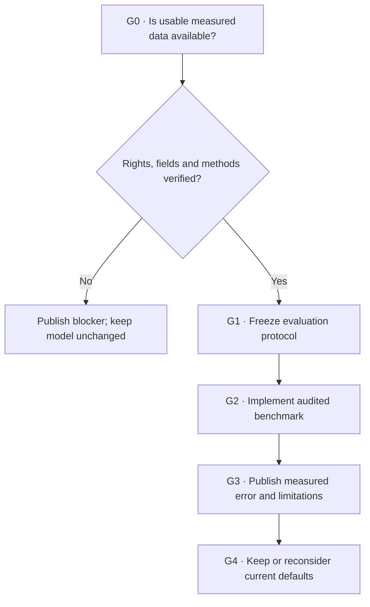

# Metron · External resting-energy validation

## At a glance

**Research question:** How closely do Metron's **resting-metabolism equations** match measured resting energy expenditure obtained by **indirect calorimetry**?

**Plan:** Qualify eligible datasets → freeze methodology → build deterministic benchmark → report actual error and uncertainty → decide whether findings warrant changing anything.

**Status:** **G0 passed for enable_data.tsv; G1 protocol freeze is next.** We verified the actual public release's files and hashes, source rights and field availability, without computing predictions or accuracy. [Read the source audit](./G0_SOURCE_AUDIT.md) · [Machine evidence](./G0_FILE_VERIFICATION.json). Production TDEE remains unchanged.

**One place to track:** [GitHub research dashboard — #9](https://github.com/andydrewie/metron/issues/9) · [Machine plan](./plan.json) · [Source candidates](./candidate-sources.json) · [Current science](../../docs/SCIENCE.md)

> Measure what we can. Question what we infer. Improve what we can demonstrate.

## The problem we're actually solving

Metron estimates daily expenditure by combining resting equations with **additional walking and workout assumptions**. A calculator can pass every software test and still be physiologically wrong. Our prior device-free perturbation experiment quantified *sensitivity*, not empirical accuracy.

This study isolates the resting-energy term. **RMR/REE ≠ TDEE**. Doubly labeled water (DLW) measures total daily energy expenditure, and cannot simply substitute for indirect-calorimetry measured resting metabolism. Neither study validates the Readiness heuristic.

Published validation studies have reported meaningful population differences: community-living adults and individuals with obesity may have different error profiles. We should test generalizability rather than advertise one universal percentage. [Relevant example](https://www.sciencedirect.com/science/article/pii/S0261561413001003).

## Progress at a glance

| Gate | Task | Issue | Status | Exit evidence |
| --- | --- | --- | --- | --- |
| **G0** | Dataset eligibility and rights | [#10](https://github.com/andydrewie/metron/issues/10) | **Passed · enable TSV** | Verified license, hashes, field availability and source methodology |
| **G1** | Freeze study methodology | [#11](https://github.com/andydrewie/metron/issues/11) | Not started | Reproducible preregistered comparison |
| **G2** | Build benchmark pipeline | [#12](https://github.com/andydrewie/metron/issues/12) | Not started | Passing code/quality/metric tests |
| **G3** | Analyze measured errors | [#13](https://github.com/andydrewie/metron/issues/13) | Not started | Published reproducible error report or blocker |
| **G4** | Calibrate our decision | [#13](https://github.com/andydrewie/metron/issues/13) | Not started | Keep model or justify an explicit new ADR |

Statuses reflect the latest documented audit; **GitHub Issues** are the living progress record. No deadline or velocity KPI. Code/research advancement requires evidence, not arbitrary completion percentages.

## How decisions advance

**Text equivalent:** No qualified data means publish the blocker and stop. Qualified data enables a frozen analysis protocol, audited benchmark, empirical report and a separate decision; no model change is automatic.

## Data candidates, ranked by immediate investigative value

**Why a table here?** These are source-admission judgments, not empirical outcomes; a comparison chart would imply a degree of measurement we don't yet have.

| Source | What the publication/catalog says | Current blocker | Study relevance |
| --- | --- | --- | --- |
| [enable cohort · Zenodo](https://zenodo.org/records/17735477) | Study reports **454** participants and indirect-calorimetry RMR. Files listed include `enable_data.tsv` plus Excel cohort tables. | **Actual participant fields, reuse rights, uniqueness and eligible row count unverified.** | First source to inspect |
| [Navalta inclusive cohort · Dataverse](https://dataverse.harvard.edu/dataset.xhtml?persistentId=doi:10.7910/DVN/MIOESN) | Study reports **94** people; NLM catalog lists **CC0** dataset with measured RMR, age, height, mass, resting heart rate. | Catalog description doesn't list the sex-equation input. Must audit actual file; cannot manufacture that input. | Potential independent check, subject to valid model mapping |
| [University of Bath · BATH-01393](https://researchportal.bath.ac.uk/en/datasets/dataset-for-are-there-sex-differences-in-the-variability-of-fasti/) | Study reports **208** participant records with RMR and body mass. | Access on researcher request; other required fields and repeat structure unverified. | Fallback, not assumed accessible |
| [IAEA DLW](https://www.dlwdatabase.org/) | Over **7,000** full-day energy-expenditure measurements. | **Different measurement endpoint**, plus access governance. | Separate future TDEE study, not G0 |

**As of November 6, 2026, one file—enable_data.tsv—is qualified for protocol design; the other candidates remain unadmitted.** [G0 evidence audit](./G0_SOURCE_AUDIT.md) distinguishes verified data fields from untested predictive accuracy. **Data admission is conditional.** Published N is not analyzed N. "Open" or "downloadable" doesn't alone establish a suitable file-level license or inclusion protocol. We must independently confirm each candidate's actual usable fields and permission terms. The [machine-readable source register](./candidate-sources.json) intentionally records unknowns.

Avoid an attractive trap: a large dataset's **model-derived basal metabolic rate** is not ground-truth calorimetry. Comparing one equation to another derived output measures agreement between models, not accuracy against humans.

## What counts as a rigorous comparison?

### G1 · Freeze the protocol before results

- **Target:** measured **resting** expenditure in kcal/day, with a documented indirect-calorimetry method. Convert energy units explicitly: **1 kcal = 4.184 kJ**.
- **Mifflin–St Jeor:** use the *published current core*, requiring mass, height, age, and an appropriate binary equation parameter. Do not infer that parameter from identity or guess missing values.
- **Cunningham:** include only people with valid fat-free mass or defensible body-composition inputs. For Mifflin-versus-Cunningham comparisons, restrict both to the **same participants**. SMM alone is not FFM.
- **Participants:** define whether multiple measures belong to the same person and prevent pseudoreplication. Identify whether cohorts overlap across different files or publications.
- **Quality:** report missingness, impossible anthropometry, inconsistent units, nonstandard resting/fasting conditions, and selection limitations.
- **No tuned coefficients or leakage:** published equations are fixed; a revised formula trained on this dataset would need a separate, appropriately held-out evaluation.

### G2–G3 · Compute and disclose

| Evidence measure | Meaning |
| --- | --- |
| **MAE** | Mean absolute difference between estimated and measured RMR; primary |
| **Mean signed bias** | Mean `predicted − measured`; systematic under/overprediction |
| **RMSE** | Squared-error sensitive measure, highlighting large misses |
| **Median absolute error** | Robust complement to MAE |
| **Within ±10%** | Share of people with relative error no greater than 10%; descriptive, **not** our pass threshold |
| **Confidence interval** | Uncertainty around the **cohort-level** error measure, not a personalized RMR interval |
| **Subgroup estimates** | Exploratory variation by age, body size, source population and equation parameter, with explicit N/uncertainty |

**Preregister the actual bootstrap algorithm, number of replicates, random seed, grouping unit, exclusions and subgroup interpretation at G1.** Where repeat measurements exist, resample people rather than treating every measurement as an independent person. Don't manufacture confidence intervals for sparse groups.

A participant-independent report must include data source/version and checksums, sample flow from raw rows to analysis rows, equation version, reference method, and warnings. The code and synthetic tests must be reproducible without publishing unauthorized individual health records.

### G4 · Interpret, then decide

Our default equation is **not automatically replaced** because another formula wins a single cohort. We must examine paired errors, effect sizes, uncertainty, applicability of the population, practical value, and counterevidence. A real consequential change merits an ADR and versioned model contract; otherwise preserve the original and publish the negative or inconclusive finding.

**Stopping is allowed.** If G0 finds no properly licensed analyzable data, record the specific access blocker and do not fake a validation experiment. If a later dataset yields no useful difference, that is an informative outcome.

## How we project-manage this without bureaucratic drag

The single [GitHub program issue](https://github.com/andydrewie/metron/issues/9) is the human dashboard. Four subordinate issues isolate independently testable deliverables. Each must state **inputs → evidence → exit condition**; a verified PR closes the relevant task when the gate passes.

Agents orient using [`AGENTS.md`](../../AGENTS.md), discover the workflow through [`docs/navigation.json`](../../docs/navigation.json), and read the machine [`plan.json`](./plan.json). No fixed dates, forced new ADRs, or fake percent-complete indicators. No individual data committed to GitHub.

## References

- [Brandl et al. enable study dataset (Zenodo)](https://zenodo.org/records/17735477) · [laboratory measurement methods](https://doi.org/10.1152/ajpendo.00375.2025).
- [Navalta et al. (2026), inclusive RMR equation](https://intjexersci.com/ijes/vol19/iss2/19/) · [Harvard Dataverse](https://dataverse.harvard.edu/dataset.xhtml?persistentId=doi:10.7910/DVN/MIOESN).
- [Bath measured fasting metabolism dataset](https://researchportal.bath.ac.uk/en/datasets/dataset-for-are-there-sex-differences-in-the-variability-of-fasti/).
- [Mifflin et al., 1990, original REE equation](https://doi.org/10.1093/ajcn/51.2.241).
- [RMR equation bias study in 337 community-living adults](https://www.sciencedirect.com/science/article/pii/S0261561413001003).
